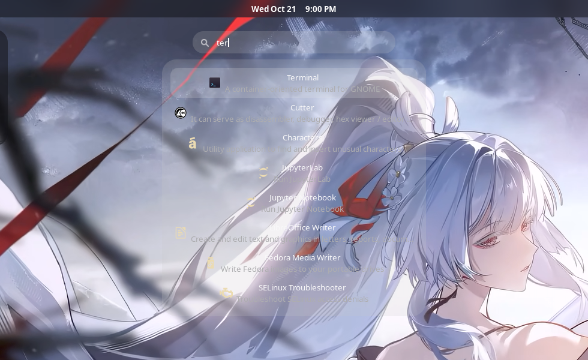

# Deskfield

An inline application and settings search, docked just under the top bar. Type
to search and a results list drops down — like the GNOME overview search, but
always available on the desktop without opening the overview.

Results come from your installed applications and from GNOME's search providers
(Settings, Files, and any other app that registers one), so `fire` finds
Firefox and `print` finds the Printers settings panel.



## Features

- Always-visible search field, centred under the top bar on the desktop.
- Looks exactly like the native overview search and follows your system theme.
- Results from applications and GNOME search providers (Settings, Files, …).
- Keyboard navigation: type, use <kbd>↑</kbd>/<kbd>↓</kbd>, press <kbd>Enter</kbd> to launch, <kbd>Esc</kbd> to clear.
- Click outside the field to dismiss it.
- Configurable vertical offset, results width, result count, search icon, and focus shortcut.

## Requirements

- GNOME Shell 50 (Wayland or X11).

## Install from source

```sh
make install
```

Then log out and back in, and enable **Deskfield** in the Extensions app.

## Build a zip

```sh
make pack
```

This produces `deskfield@MoriartyPuth.github.io.shell-extension.zip`.

## Settings

Open the extension's preferences (Extensions app → Deskfield → Settings):

- **Position** — the vertical offset below the top panel, as a percentage of
  the monitor height. The field is always centred horizontally.
- **Results width** — width of the results list in pixels.
- **Maximum results** — how many results to show at once.
- **Show search icon** — toggle the magnifier icon.
- **Shortcut** — the key combination that focuses the field.

## License

Deskfield is released under the GNU General Public License v2.0 or later. See
[`LICENSE`](LICENSE).
